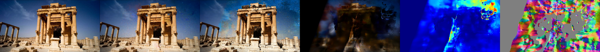
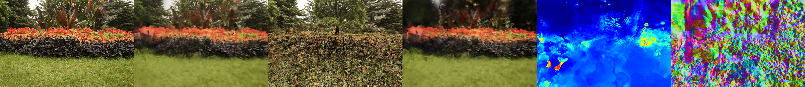
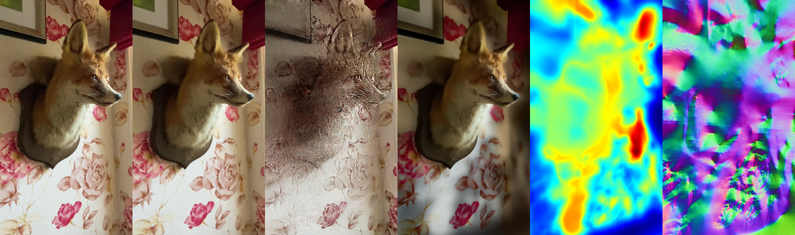
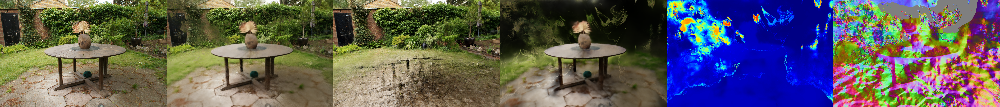
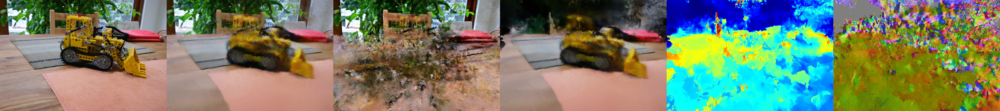
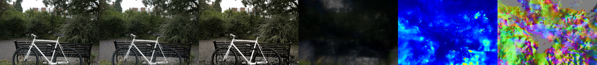

<div align="center">

# UniSDF: Universal Neural Surface Reconstruction with Differentiable Rendering

</div>

> **Note**: This repository is a custom **reimplementation of the UniSDF paper**: *Unifying Neural Representations for High-Fidelity 3D Reconstruction of Complex Scenes with Reflections*.
> This repository is a highly optimized, lightning-fast implementation of the **UniSDF** paper built on top of high-speed multi-resolution hash grids. Reconstruct complex, detailed, and highly reflective surfaces directly from raw 2D images in minutes—no Docker required!

---

## Key Features of UniSDF

We have integrated the core mechanics of the UniSDF paper into a high-performance training pipeline:

1. **Mip-NeRF 360 Proposal Sampling**: Speeds up training dramatically by using a lightweight proposal network to predict density intervals, only querying the heavy geometry network at the most optimal sample coordinates along the camera ray.
2. **VolSDF (Laplace) Density Parameterization**: Uses a Laplace distribution function to convert signed distance values into volume densities, forcing sharp, clean boundary interfaces that avoid over-smoothed geometry.
3. **Camera and Reflected Radiance Composition**: Decouples appearance into **Diffuse** and **Specular** components. By predicting view-dependent specular reflection directions $r = v - 2(v \cdot n)n$ and blending them with a learned 3D weight field, UniSDF perfectly captures mirror-like surface reflections.
4. **Coarse-to-Fine Scheduling**: Prevents overfitting and geometric "floaters" by scheduling multi-resolution hash grid activation level-by-level alongside progressive finite difference boundaries.

---

## Installation & Setup

Set up UniSDF natively in minutes on any standard CUDA-enabled Linux environment:

### 1. Prerequisites

Ensure you have a CUDA compiler toolkit installed on your machine.

### 2. Create and Activate Virtual Environment

```bash
python -m venv venv
source venv/bin/activate
```

### 3. Install Dependencies

```bash
# Install PyTorch with CUDA support
pip install torch torchvision --index-url https://download.pytorch.org/whl/cu121

# Install NVlabs tiny-cuda-nn bindings
pip install git+https://github.com/NVlabs/tiny-cuda-nn/#subdirectory=bindings/torch

# Install the rest of the dependencies
pip install -r requirements.txt
```

---

## Workflow: How to Run

### Step 1: Data Preparation

Place your dataset images under a structured folder (e.g., `data/Bike/images`).

### Step 2: Run End-to-End Reconstruction (COLMAP + Training)

Use our unified, streamlined shell scripts inside the `scripts/run/` folder to run SfM camera alignment followed by model optimization.

* **For standard sparse point cloud scenes:**
  ```bash
  bash scripts/run/run_unisdf-colmap_sparse.sh data/Bike
  ```
* **For dense multi-view stereo scenes (utilizes depth prior models):**
  ```bash
  bash scripts/run/run_unisdf-colmap_dense.sh data/Bike
  ```
* **For scenes with masks:**
  ```bash
  bash scripts/run/run_unisdf-colmap_sparse_mask.sh data/Bike
  ```

### Step 3: Run Detached Background Jobs (Cluster Friendly)

Submit training runs into background processes with organized log files on any specific GPU:

```bash
bash scripts/run/submit_unisdf.sh Bike 1
```

---

## Gallery & Demonstrations

Here are the incredible reconstruction results rendered and exported directly from our UniSDF checkpoints!

> **Note on videos:** GitHub's README renderer strips `<video>` tags, so fly-through clips are embedded below as **clickable thumbnails** — click any reconstruction image to play the corresponding fly-through video in your browser.

### 1. Baalshamin (Reflective Surface details)

**Reconstruction Output (Step 95k) — click to watch the fly-through (Step 100k):**

<p align="center">
  <a href="https://raw.githubusercontent.com/rishidevde/UniSDF/UniSDF-Paper-Implementation/assets/baalshamin_video.mp4">
    
  </a>
</p>

---

### 2. Flowers (Complex high-frequency geometry)

**Reconstruction Output (Step 95k) — click to watch the fly-through (Step 100k):**

<p align="center">
  <a href="https://raw.githubusercontent.com/rishidevde/UniSDF/UniSDF-Paper-Implementation/assets/flowers_video.mp4">
    
  </a>
</p>

---

### 3. Fox (Detailed specularity)

**Reconstruction Output (Step 95k) — click to watch the fly-through (Step 100k):**

<p align="center">
  <a href="https://raw.githubusercontent.com/rishidevde/UniSDF/UniSDF-Paper-Implementation/assets/fox_video.mp4">
    
  </a>
</p>

---

### 4. Garden (Glossy sphere reflections)

**Reconstruction Output (Step 100k) — click to watch the fly-through (Step 100k):**

<p align="center">
  <a href="https://raw.githubusercontent.com/rishidevde/UniSDF/UniSDF-Paper-Implementation/assets/garden_video.mp4">
    
  </a>
</p>

---

### 5. Kitchen (Multi-object environments)

**Reconstruction Output (Step 100k) — click to watch the fly-through (Step 100k):**

<p align="center">
  <a href="https://raw.githubusercontent.com/rishidevde/UniSDF/UniSDF-Paper-Implementation/assets/kitchen_video.mp4">
    
  </a>
</p>

---

### Last Result: Bicycle (Thin structure resolution)

**Generated Reconstruction Surface (Step 100k):**

<p align="center">
  
</p>

---

## Post-Processing: Color Mesh Extraction

You can extract highly detailed, vertex-colored 3D meshes (outputs both high-compatibility **`.obj`** and **`.ply`** files directly readable in Blender) from any of your checkpoints:

```bash
python extract_colored_mesh.py \
    --config configs/unisdf-colmap_sparse.yaml \
    --checkpoint exp/unisdf-colmap_sparse-Bike/<trial_name>/ckpt/last.ckpt \
    --output Mesh_outputs/bike_reconstructed.obj \
    --resolution 1024
```

*Bakes and extracts both `.obj` and `.ply` textured formats seamlessly using xatlas texture coordinates.*